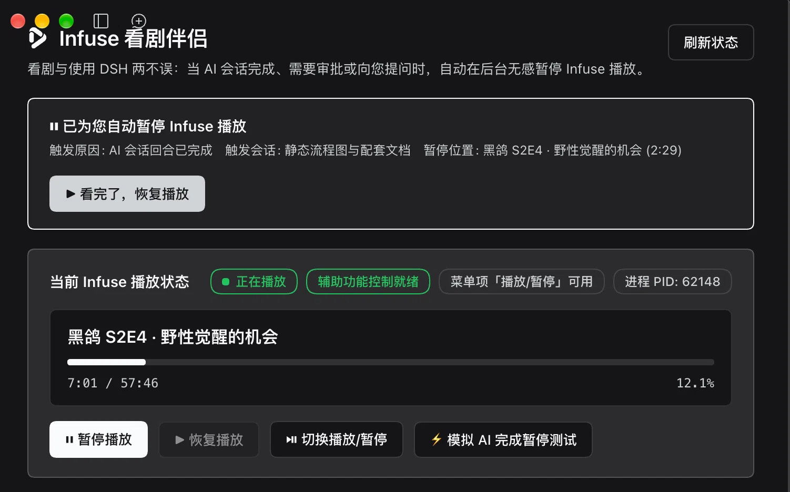

# DSH Infuse 看剧伴侣

在 DSH 中运行 AI 会话时，如果 Infuse 正在播放剧集/电影，插件会在**AI 回合完成、需要你审批、或 AI 向你提问**时自动暂停 Infuse，避免剧情被错过；左侧栏提供控制面板，可查看实时播放状态、手动暂停/恢复、开关自动暂停规则。



## 功能

- **左侧栏入口 + 主面板**：实时显示当前剧集/电影、播放进度（按本地时钟逐秒平滑推进）、PID、辅助功能与菜单项状态。
- **三种自动暂停时机**（可独立开关）：
  - AI 会话回合完成时（`turn/end`）
  - 需要工具/权限/计划审批时（`approval/request`、`user-questions/request` 的 approval/plan-review intent）
  - AI 调用 `ask_user_question` 向你提问时
- **仅主会话**：默认忽略后台子代理的回合结束，避免看剧被打断。
- **安全暂停**：暂停前先读取 Infuse 本地 Now Playing 状态，只有 `state === "playing"` 才触发；不会把已暂停的视频误触为播放，也不会抢占窗口焦点。
- **一键恢复**：自动暂停后，面板顶部出现横幅，看完 AI 回复点「看完了，恢复播放」即可继续。
- **自动暂停记录**：记录每次触发原因、会话标题、暂停位置与时间。
- **Agent 工具**：`infuse_companion`（`status` / `pause` / `resume` / `toggle` / `configure` / `simulate_trigger` / `clear_history`），与 UI 共用同一套 Host 逻辑。

## 环境要求

- macOS（使用 `ApplicationServices` 辅助功能接口控制 Infuse 菜单项）
- [Infuse for macOS](https://firecore.com/infuse)（需正在运行）
- Xcode Command Line Tools（`xcode-select --install`）：用于首次使用时编译 `bin/infuse-ax` 辅助程序；已编译的 arm64 二进制可自行放入 `bin/` 以跳过编译
- DSH 0.2.x（`plugin_manager` 与 Web GUI）

## 安装

### 方式一：本地目录（开发调试）

```text
plugin_manager install_bundle target=/Users/<you>/githubcode/dsh/infuse-companion
```

### 方式二：从 GitHub 安装

```text
plugin_manager install_bundle target=github:<your-github-user>/dsh-infuse-companion
```

也可以让 DSH 中的 Agent 直接执行上述安装（需要 `plugin_manager` 工具权限）。

安装后左侧栏会出现 **「Infuse 伴侣」** 图标；若图标/文案未刷新，刷新页面或重启 DSH 即可。

## 配置

配置写入 profile 的 `cordis.patch.yml`，也可以在面板中直接开关（通过 config editor 持久化）：

```yaml
- id: infuse-companion
  name: '@local/dsh-infuse-companion'
  config:
    enabled: true                    # 自动暂停总开关
    pauseOnTurnComplete: true        # AI 回合完成时暂停
    pauseOnApprovalNeeded: true      # 需要审批时暂停
    pauseOnQuestionAsked: true       # AI 提问时暂停
    onlyRootSessions: true           # 仅主会话，忽略子代理
    cooldownSeconds: 3               # 触发冷却，避免连续暂停
```

## 工作原理

1. Host 端监听 DSH 事件：`session/event`（`turn/end`，跳过用户手动停止）、`approval/request`、`user-questions/request`。
2. 触发时先确认 Infuse 正在运行，并通过其本地 Now Playing HTTP 服务（`_infuse-np._tcp` → `/nowplaying`）读取真实播放状态。
3. 仅当状态为 `playing` 时，调用随插件分发的 Swift 辅助程序 `bin/infuse-ax`，用 macOS 辅助功能（`AXPress`）触发 Infuse 的「播放/暂停」菜单项——不激活窗口、不影响前台操作。
4. 暂停后等待约 360ms 复核状态，写入记录，并在面板横幅中提示一键恢复。
5. 面板通过插件自己的受 DSH Web 鉴权保护的 JSON 路由 `/infuse-companion/api` 与 Host 通信。

## 目录结构

```text
infuse-companion/
├── package.json          # DSH bundle + Client 声明
├── cordis.patch.yml      # 默认配置
├── index.js              # Host：事件监听、暂停逻辑、Web 路由、Agent 工具
├── client.js             # Client：左侧栏图标 + 主面板 UI
├── bin/infuse-ax.swift   # 辅助程序源码（首次使用自动编译）
├── locale/               # 中英文案与插件元数据
├── icon.png              # 插件管理页图标
└── docs/preview.webp
```

## 已知限制

- 仅 macOS：依赖辅助功能接口；首次使用需允许 DSH 使用「辅助功能」。
- 暂停方式是切换播放/暂停，因此严格依赖 Infuse 上报的播放状态；若 Infuse 状态接口异常，插件会跳过而不是盲按。
- 子代理（Subagent）默认不触发；如需也暂停，关闭 `onlyRootSessions`。
- 面板的播放进度按本地时钟插值实现逐秒平滑推进；手动拖动 Infuse 进度后会自动重新对齐。

## 许可证与图标

- 代码：[MIT](LICENSE)
- 图标：Infuse 官方图标版权归 [Firecore](https://firecore.com/) 所有，仅用于个人本地使用的插件展示；如需公开发布/分发，请替换为你自己的美术资源或取得授权。
- 本插件与 Firecore / Infuse 无官方关联。
